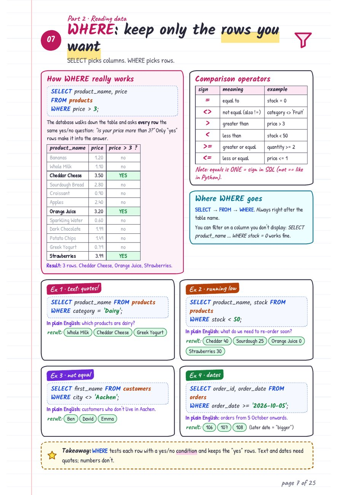
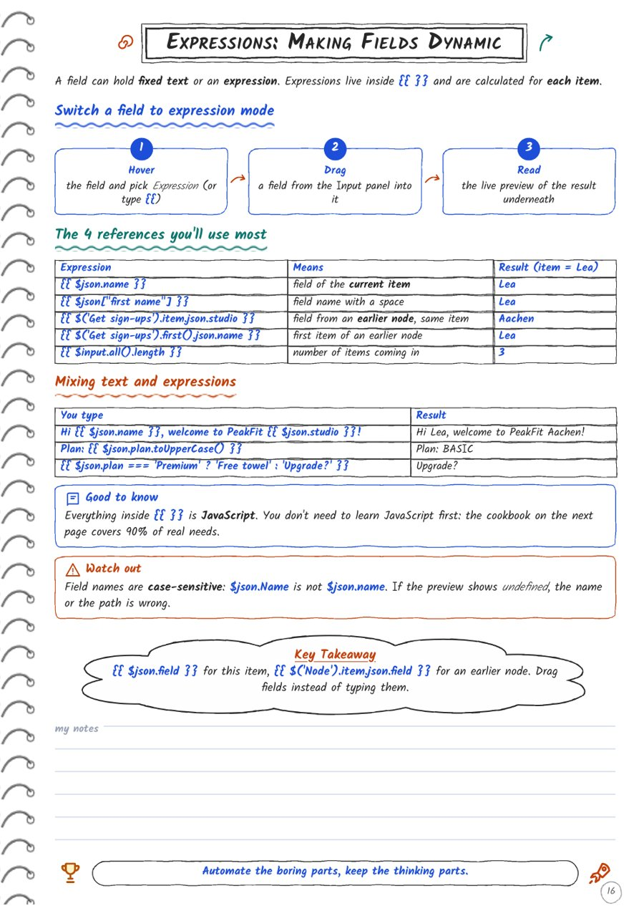

**What I wanted:** handwritten-looking notes for my interview prep (DAX, SQL, Power BI), like the ones people share online, without drawing them by hand.

## Method 1: one long prompt, Claude makes the whole PDF

My first approach was one long prompt, the same one for every topic:

> Create a downloadable PDF called "[TOPIC]: Zero to Confident." Teach me [TOPIC] from scratch. Assume I'm a complete beginner with no prior knowledge of the subject or its tools.
>
> Check official documentation or other authoritative references before writing. Include a short list of the sources you used at the end.
>
> Make the PDF look like handwritten study notes in a spiral notebook, with ruled pages, colored headings, short explanations, and a boxed "Key Takeaway" on each page. Use as many pages as needed to explain the topic clearly.
>
> Start with what [TOPIC] is, why it matters, and how its core concepts fit together. Explain unfamiliar terms in plain English and use everyday analogies before introducing technical details. Build from the basics to practical applications, and label advanced material as optional.
>
> Walk me through a simple first exercise using sample data or materials where relevant. Then include a few practice exercises of increasing difficulty and two end-to-end projects or worked examples. For each one, show what I need, what to do, what result to expect, and how to check my work or troubleshoot common mistakes.
>
> Finish with a quick-reference cheat sheet, beginner Q&A, and a practice roadmap I can follow on my own.

I described the look in one sentence and left everything else (fonts, layout, how many pages) to Claude. Claude researched the topic, wrote the content, designed the pages and built the PDF, all in one go.

**Why it costs a lot of tokens:**
- **Claude does every job:** research, writing, layout and creating the PDF itself. All of that work counts.
- **"As many pages as needed" means a very long answer.**
- **Every new topic repeats the full job,** including the design work.
- **Any fix means another full run.** And the look changes from topic to topic.

## Method 2: the design is fixed, Claude writes only the content

**Step 1: The design is fixed once, in a Python notebook.**
- Fonts, colours and page style never change: Kalam handwriting, plus Delius for a clearer capital "I" so "I2" never reads as "12".
- Settings live in one cell: input file, output file and ink colours.

**Step 2: Claude writes the content only, in Markdown.**
- I give it a short prompt (about 600 tokens) plus my two-page format guide (about 570 tokens). The guide lists the markers the notebook understands, such as `==highlight==`, `> tip:`, `::: box` and `> takeaway:`.
- Claude uses official docs as sources and returns one plain Markdown file. This is the only step that uses Claude, and Markdown is short.

**Step 3: The notebook builds the PDF on my laptop.**
- It turns the Markdown into an HTML page first, because HTML lines the text up properly, then prints that page to PDF.
- It doesn't matter how many HTML files or formats it creates along the way. This all runs locally, so it costs nothing.

## The two methods as a flow

  

    
Method 1 · Claude does everything

    

      
One long prompt<small>same for every topic</small>

      

      
Claude researches, writes and designs<small>reference websites, as many pages as possible</small>

      

      
Claude creates the PDF<small>all inside Claude</small>

    

    
↺ New topic or a fix? Claude repeats the whole job, and every step uses tokens

  

  

    
Method 2 · Claude writes, my notebook builds

    

      
Design fixed once<small>Python notebook: fonts, colours, layout</small>

      

      
Claude writes content only<small>Markdown, the only step that uses tokens</small>

      

      
Markdown to HTML<small>on my laptop, free</small>

      

      
HTML to PDF<small>on my laptop, free</small>

    

    
↺ Want a change? Edit one setting and re-run, for free

  

## What each method produced

  <figure>
    
    <figcaption><strong>Method 1:</strong> SQL notes, 25 pages. Claude chose the whole design.</figcaption>
  </figure>
  <figure>
    
    <figcaption><strong>Method 2:</strong> n8n notes, 42 pages. Same design every time, built for free.</figcaption>
  </figure>

Both full PDFs are in the <a href="https://github.com/vgs1004/MyProjects/tree/main/Handwritten%20Notes%20Maker%20%28Python%29">project folder on GitHub</a>.

## What I learned

- **Separate content from design.** It's the same idea as a template in Word or a theme in Power BI.
- **Use the AI only where it adds value.** Writing the content needs Claude. Building the PDF doesn't.
- **A two-page "format guide" is a better prompt than a long description of the look.**
- **You don't need to be a developer.** I built the notebook by describing what I wanted to Claude and checking each page.
